<div align="center">

# Voxel Engine

**A GPU-driven voxel engine in Rust and Vulkan, with a Hytale-style node-graph world generator
you edit live.**

[](https://github.com/Distorbed678/voxel-engine/actions/workflows/ci.yml)


[](#license)

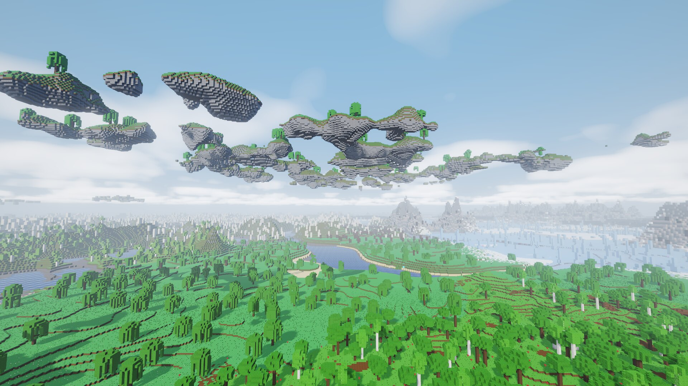

<sub>Every frame on this page was rendered by the engine itself from a script
(<a href="docs/media/build.sh"><code>docs/media/build.sh</code></a>).</sub>

</div>

Everything about the world happens on the GPU: generation from the node graph, trees and other
props, greedy meshing, occlusion culling and drawing. The CPU only decides which chunks to build. The view
reaches about **4 km** through nested LOD clipmaps of 32³ chunks, and the world is infinite on
all three axes. There is no player or gameplay: you get a free-flying camera, editing tools and a
Dear ImGui debug UI.

<div align="center">
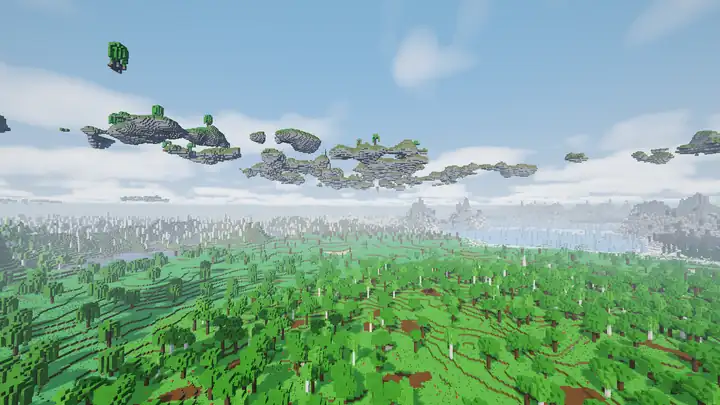
<sub>Flythrough (8 s). <a href="docs/media/flythrough.mp4">Watch the 720p MP4</a>.</sub>
</div>

## Highlights

| | |
|---|---|
| **GPU world pipeline** | Compute shaders generate terrain, place props and greedy-mesh chunks into packed 8-byte quads. Task and mesh shaders cull every chunk and face direction and expand the quads, all from one indirect dispatch. |
| **Node-graph world generator** | Typed World → Zone → Biome graphs plus reusable Function graphs, compiled to GLSL. Parameter edits regenerate the world instantly; structural edits rebuild the shaders in the background. |
| **4 zones, 12 biomes, 4 cave biomes** | Meadows, forests, birch hills, floating isles, desert, badlands, savanna, taiga, glaciers, snowy peaks, ashlands and lava fields above ground. Below it: lush, crystal, magma and frost caves in spaghetti, cheese and noodle cave systems and ravines. Rivers run at sea level, with ores, geodes and prefab ruins. All of it is ordinary, editable graphs. |
| **Light** | Colored block light and sky light are propagated on the GPU in a volume around the camera, with a coarse far-field volume so distant lava still lights its banks. Caves go dark and lanterns, lava and crystals light them. |
| **Weather and particles** | Snow, rain, drifting ash, rising embers, fireflies at night and pollen by day, set per biome and scaled by a weather cycle. Rain and snow stay out of caves and from under roofs. |
| **Stylized rendering** | Cascaded sun shadows, TAA, bloom, day/night with sun, moon and stars, volumetric clouds, waves with Fresnel reflections, per-biome fog and tints, wind on leaves, per-cell AO and normal-mapped 32×32 procedural textures. |
| **Editing that survives regeneration** | Blocks (logs and stairs orient to the face and view you place them from), brushes (add, remove, paint, smooth), box selection with fill/replace/copy/paste/rotate, undo and redo, and prefabs the generator can place. Edits live in an overlay, so they survive any graph change. |
| **Tested without a human** | A scripting mode drives the engine headless: camera, mouse and keys, tools, screenshots. GPU regression tests check picking, edits, UI capture and golden images. |

## Gallery

| | |
|---|---|
| 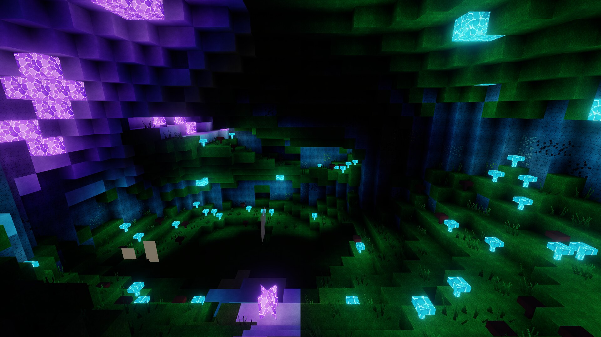 | 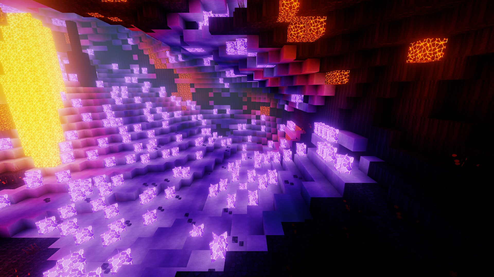 |
| *A lush cave lit only by its glowing mushrooms and crystals* | *A crystal cave under the lava fields* |
| 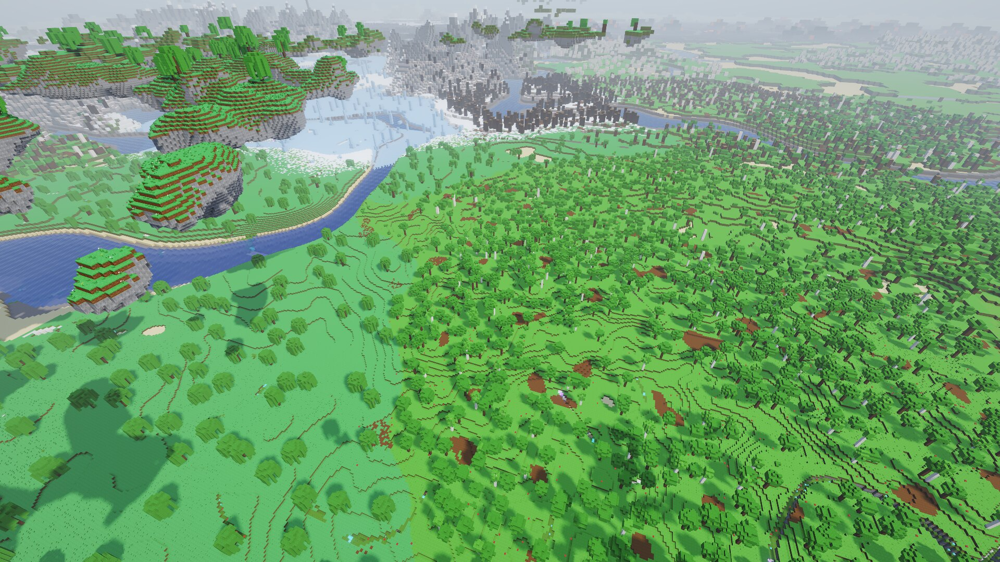 | 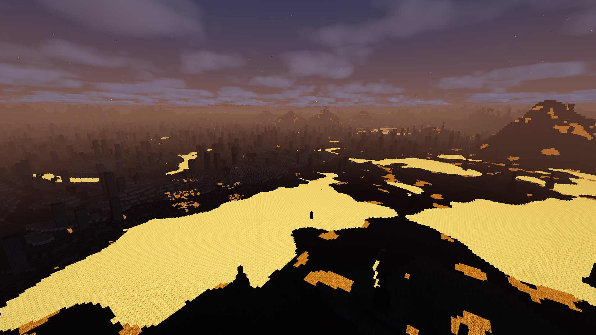 |
| *Rivers winding through the forest* | *Lava fields at night: block light and bloom* |
| 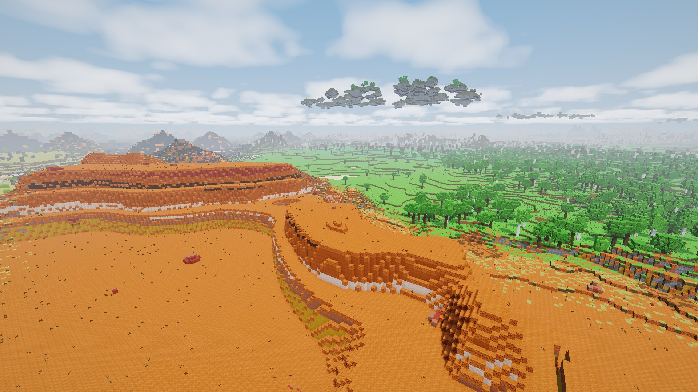 | 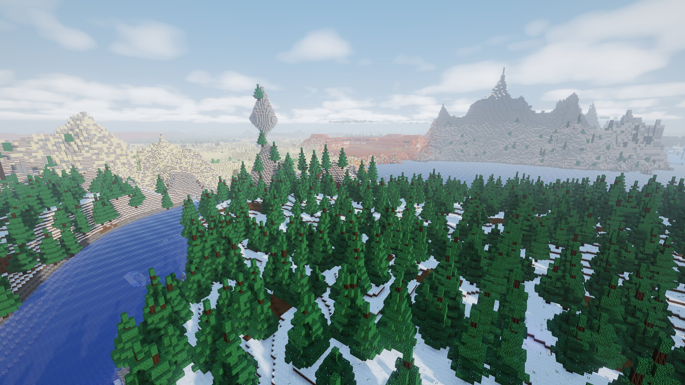 |
| *Badlands mesas next to the savanna* | *Taiga below the snowy peaks* |
| 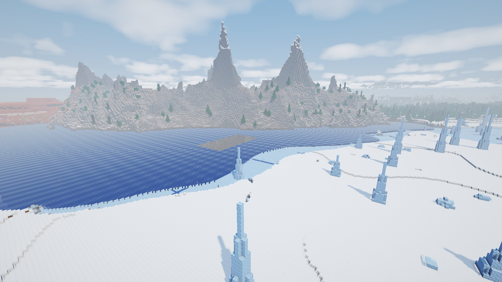 | 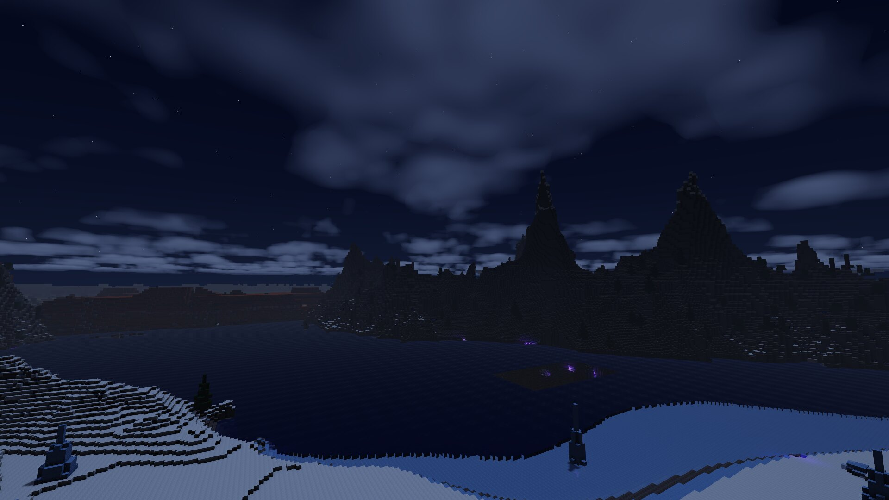 |
| *A glacier lake with ice spikes* | *The same glacier at night* |
| 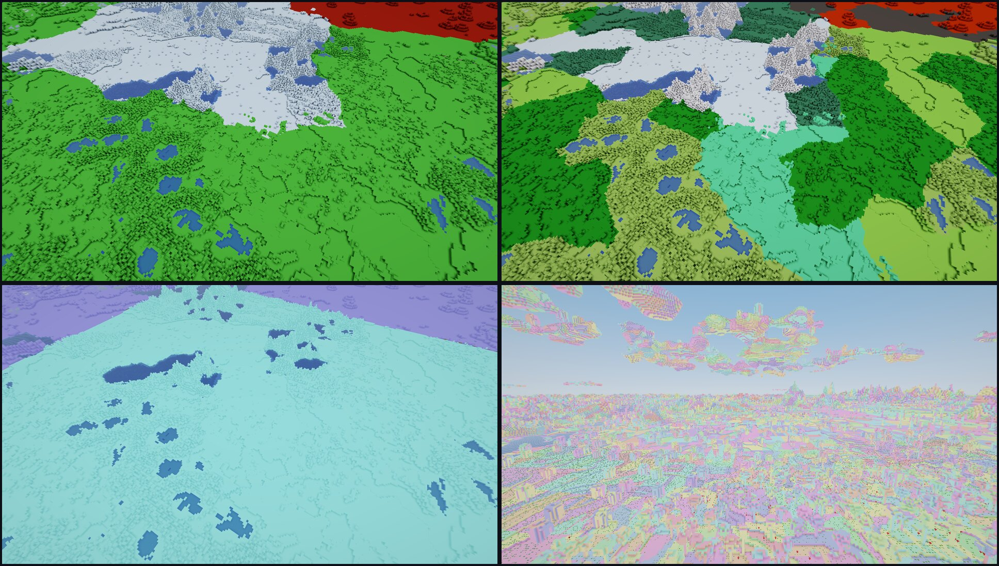 | 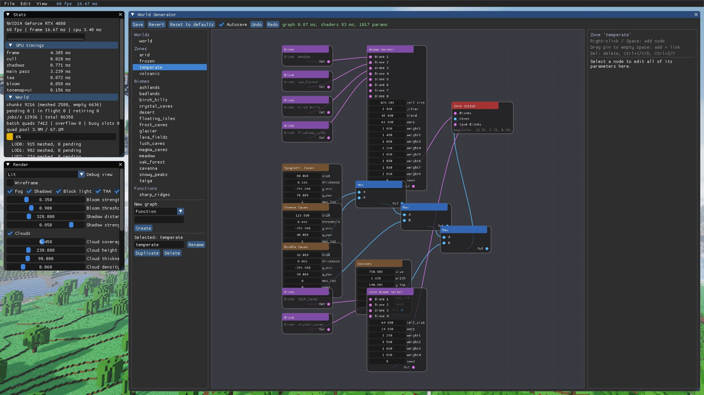 |
| *Debug views: zones, biomes, LOD levels, meshlets* | *The editor UI* |

## The world generator


The generator is a set of graphs, modelled on Hytale's world generation:

- **World**: a Zone Voronoi and a River network feeding the world output (which also holds the
  sea level).
- **Zone**: a biome layout (Biome Voronoi cells, Biome Threshold Select bands of a noise or height
  map, or a single biome), a cave carver and cave biomes
  (picked in 3D cells; they cover cave floors and ceilings and grow plants there).
- **Biome**: terrain density, materials, ground cover, up to six prop layers and environment
  colours.
- **Function**: a reusable density subgraph with four arguments.

The compiler turns them into GLSL. Every number in a graph is a live parameter in a GPU buffer, so
dragging a slider regenerates the world without recompiling. Values that only depend on X/Z are
hoisted and computed once per column. Domain warps and stretches create separate evaluation
contexts. Up to three biomes blend per column. More in
[docs/ARCHITECTURE.md](docs/ARCHITECTURE.md).

## Performance

RTX 4080, 1080p, `--benchmark` (a scripted 24 s flight at 90 blocks/s):

| Metric | Result |
|---|---|
| Average frame rate | **279 fps** (1% low: 102 fps) |
| Streaming | ~2,000 chunks/s while flying |
| Regenerating the whole 4 km world | ~0.5 s of GPU time (~9.2k chunks) |
| Occlusion culling (main pass) | 2.1 → 1.2 ms in a forest, 2.4 → 0.4 ms in a cave |
| Validation layers | 0 errors |

## Getting started

Requirements: a GPU with Vulkan 1.3+ and `VK_EXT_mesh_shader` (RTX 20 series, RX 6000 series, Arc or
newer), the `shaderc` system library (`pacman -S shaderc`, `apt install libshaderc-dev`), and
optionally `vulkan-validation-layers` for `--validate`.

```sh
git clone https://github.com/Distorbed678/voxel-engine
cd voxel-engine
cargo run --release
```

<details>
<summary><b>Controls</b></summary>

| Input | Action |
|---|---|
| `Tab` | toggle fly mode (mouse look, crosshair) |
| `Esc` | release the mouse |
| `WASD`, `Space`/`E`, `Q`/`Ctrl` | move, up, down |
| `Shift` / `Alt` / mouse wheel | fast / slow / change speed |
| RMB drag (editor mode) | look around |
| LMB / RMB / MMB (fly mode) | tool primary / secondary / pick block |
| LMB / Shift+LMB (editor mode) | tool primary / secondary |
| `Alt` + wheel | brush radius |
| `Ctrl+Z` / `Ctrl+Y` | undo / redo (also in the node editor) |
| `F1` / `F2` / `F5` | hide UI / screenshot / reload shaders |

**Node editor**: right-click or `Space` adds a node. Dragging a pin into empty space adds a node
and links it. `Del` deletes. `Ctrl+C`/`V`/`D` copy, paste and duplicate. "Group selection into
function" turns the selected nodes into a reusable function graph. **Auto-layout** tidies a graph.
A **Comment** node is a resizable box with a note; dragging it moves the nodes inside.

</details>

<details>
<summary><b>Command line</b></summary>

```
--headless --frames N --screenshot out.png   render offscreen and save a PNG
--size 1920x1080   --pos x,y,z   --look yaw,pitch (radians)   --time 0..1   --seed N
--debug-view N     (0 lit, 1 normals, 2 LOD, 3 chunks, 4 meshlets, 5 AO, 6 albedo, 7 overdraw, 8 zones, 9 biomes)
--script FILE      headless scripted run (camera, input, tools, checks); exit code 1 on failure
--benchmark        scripted 24 s flight, report saved to benchmarks/
--worldgen DIR     load generator graphs from DIR instead of assets/worldgen
--validate         enable Vulkan validation layers
--no-ui            hide the debug UI
--export-textures DIR   dump all block textures as PNGs (texture pack template)
```

Any texture can be overridden by dropping `assets/textures/<name>.png` (32×32 RGBA).

</details>

## Testing

```sh
cargo test --workspace                              # CPU tests (CI runs these)
cargo test --release -p voxel-engine -- --ignored   # GPU scripts: editing, UI, golden images
```

GPU tests are scripts in [`crates/engine/tests/scripts`](crates/engine/tests/scripts). The
language is documented at the top of
[`crates/engine/src/engine/script.rs`](crates/engine/src/engine/script.rs). For example:

```
select -20 380 0 20 420 1   # build a stone wall in the sky
block stone
op fill
pos 0.5 400.5 -8
look 180 0
settle                      # wait until streaming, meshing and shader builds are idle
click left                  # break the block under the cursor
settle
expect_block 0 400 0 air    # read the real block back from the GPU
expect_pick stone           # the layer behind it is now under the cursor
```

Scripted runs use a fixed time step, so they are deterministic. Golden images are compared at half
resolution; `UPDATE_GOLDEN=1` accepts intended changes.

## Project layout

```
crates/vkcore     Vulkan foundation: device, bindless, swapchain, shader compiler, profiler
crates/worldgen   graph model (RON), node registry, GLSL compiler, default world
crates/engine     app: streaming, GPU world pipeline, renderer, UI, node editor, tools, scripts
shaders/          GLSL (hot reloaded); worldgen/ is wrapped around the generated code
assets/worldgen   the world generator graphs (edit in-app or by hand)
assets/prefabs    saved prefabs
docs/             architecture, plan and roadmap, README media
```

[docs/ARCHITECTURE.md](docs/ARCHITECTURE.md) explains how it works.
[docs/PLAN.md](docs/PLAN.md) has the decisions, status and roadmap.

## License

Licensed under either of [Apache License 2.0](LICENSE-APACHE) or [MIT license](LICENSE-MIT), at
your option.
